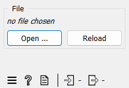

# Load Subgroups

Loads subgroups saved as a pickle by *Save Subgroups*.

**Inputs:** *Data* (optional; the table the subgroups were computed on, to
re-attach it).  **Outputs:** *Subgroups*, *Annotated Data*.

Only open pickle files you trust: unpickling can execute code.
