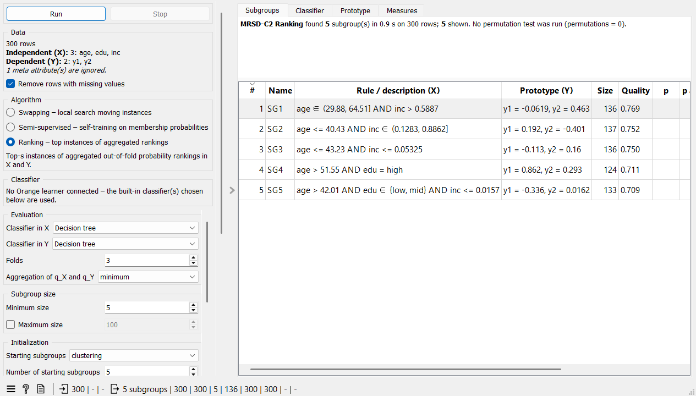
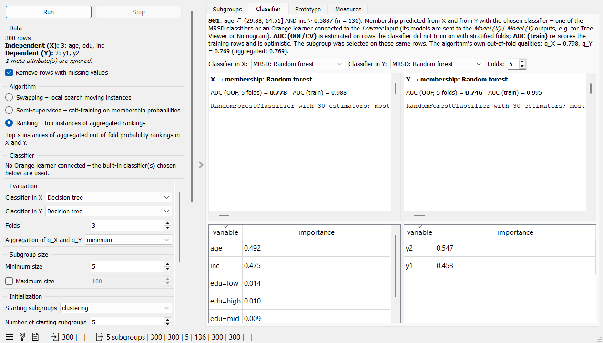
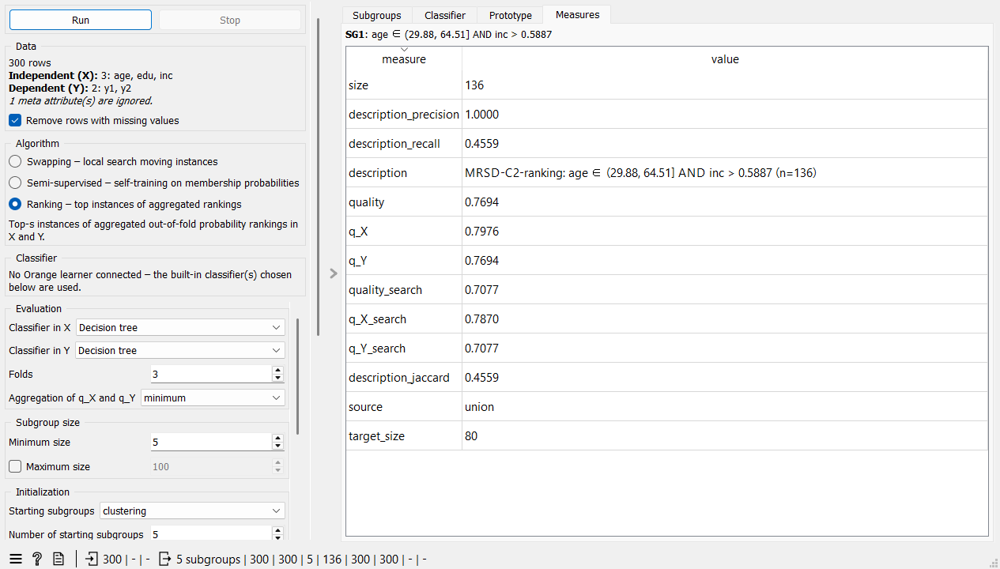
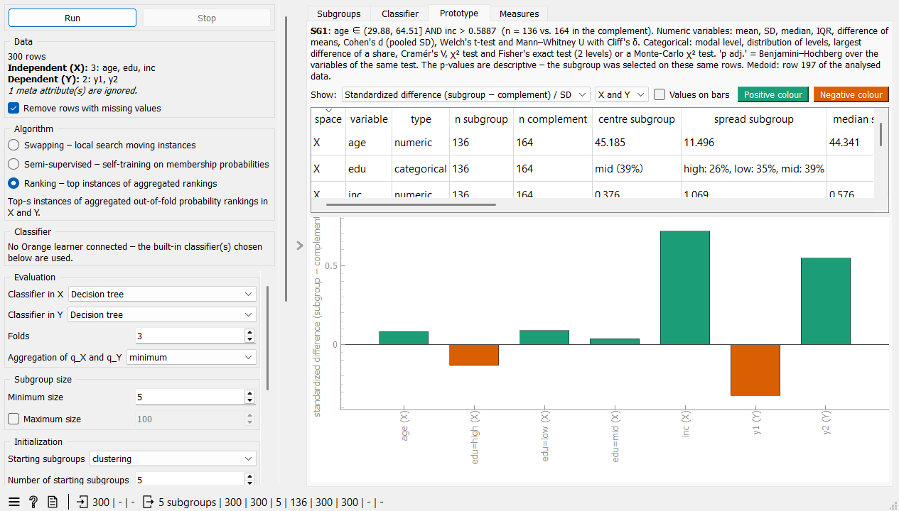

# MRSD-C2: Classification in Both Spaces

Subgroups whose membership can be predicted both from X and from Y.

## Inputs

| input | type | meaning |
|---|---|---|
| **Data** | Table | independent variables X = attributes, dependent variables Y = class variables; meta attributes are ignored |
| **Subgroups** | Subgroups | optional. If no Data is connected, the data of these subgroups is used. In MRSD-C2 the subgroups are also the starting subgroups of the search |
| **Learner** | Learner (several) | optional Orange learners (Tree, Naive Bayes, Logistic Regression …). In widgets with a *Classifier* tab they describe the selected subgroup and provide the *Model* outputs; in the classification-based algorithms they also replace the built-in classifiers of the search |

## Outputs

| output | type | meaning |
|---|---|---|
| **Subgroups** | Subgroups | the subgroups shown in the table (after the filters of the *Results* box) |
| **Data** | Table | the input data, unchanged – for chaining algorithm widgets |
| **Annotated Data** | Table | the data with one Yes/No meta column per shown subgroup |
| **Subgroups Table** | Table | one row per subgroup: rule, prototype in Y, size, quality, p-values, statistics of the dependent variables |
| **Selected Subgroup Data** | Table | the rows of the subgroup selected in the table (or chosen in an inspector) |
| **Membership Data (X)** / **(Y)** | Table | all rows with a class `in <subgroup>` (no / yes) and X, respectively Y, as features |
| **Model (X)** / **(Y)** | Model | the membership model of the selected subgroup fitted with a connected Orange learner (for Tree Viewer, Nomogram …) |

## How it works

A subgroup is scored by two out-of-fold AUCs: predicting its membership from
X (q_X) and from Y (q_Y), aggregated (minimum by default).  Three search
methods share this score:

* **Swapping** – local search from starting subgroups, moving instances in
  and out while the score improves.
* **Semi-supervised** – self-training: membership probabilities from X and Y
  are combined and thresholded to give the next version of the subgroup.
* **Ranking** – instances are ranked by their membership probabilities in X
  and in Y; the top-s instances of the aggregated ranking form candidates of
  several sizes.

Starting subgroups come from clustering or at random, or from the *Subgroups*
input (e.g. the output of another algorithm).

## Classifiers

Without a connected learner the built-in classifiers chosen in the widget are
used.  When at least one Orange learner is connected to the *Learner* input,
*Use the connected Orange learner(s)* appears (ticked) and the built-in
choice is hidden: *Learner for X* and *Learner for Y* choose which connected learner is used in which space.  Slow learners (random forest, SVM) make the search
slow, because every candidate is scored by cross-validation.

## Running

*Run* (top and bottom of the control area) starts the computation in a
separate process: Orange stays responsive, other widgets can run at the same
time and *Stop* really stops the run.  *Run in a separate process* can be
switched off if the process cannot be started on your system.  Progress is
written to the console Orange was started from (lines beginning with `[MRSD`).

Rows with missing values in X or Y are removed when *Remove rows with missing
values* is ticked (default).

## Results box

* **Measure** – the algorithm's quality or any numeric measure it records.
* **Show only measure ≥** – filter on the chosen measure.
* **Show only adjusted p <** – filter on the family-wise adjusted p-value
  (only meaningful when permutations > 0).
* **Sort by** – the measure (default), p-values, size or order of discovery.

The filters apply to the table and to the outputs.

## Permutation inference

Permutation tests are **off by default** (Permutations = 0).  When
switched on, the raw p-value, the family-wise adjusted p-value (Westfall–Young
max-T, or a re-run of the whole search on permuted data) and the
Benjamini–Hochberg value are added.  Search-level permutations repeat the
whole search and can be slow.

## Tabs of the main area

* **Subgroups** – the table: rule / description in X, prototype in Y (means
  and modal levels), size, quality, p-values and the difference of every
  dependent variable from the whole data.
* **Classifier** – the membership classifiers in X and in Y side by side.
* **Prototype** – descriptive statistics of every X and Y variable in the
  subgroup and in its complement (mean, SD, median, IQR or level shares),
  effect sizes, a parametric and a non-parametric test per variable
  (Welch t / Mann–Whitney U; χ² / Fisher exact or Monte-Carlo χ²) and a bar
  chart with several display variants.  The p-values are descriptive: the
  subgroup was selected on the same data.
* **Measures** – everything the algorithm recorded about the subgroup.

## Parameters

| group | parameter | default | notes |
|---|---|---|---|
| Evaluation | Classifier in X | Decision tree | Every candidate is scored out-of-fold with this classifier – a tree is fast, a forest is slow Options: Random forest; Decision tree; Logistic regression; SVM (RBF); SVM (linear); Naive Bayes; k-nearest neighbours; Gradient boosting; AdaBoost; Neural network (MLP). |
| Evaluation | Classifier in Y | Decision tree | Options: Random forest; Decision tree; Logistic regression; SVM (RBF); SVM (linear); Naive Bayes; k-nearest neighbours; Gradient boosting; AdaBoost; Neural network (MLP). |
| Evaluation | Folds | 3 |  |
| Evaluation | Aggregation of q_X and q_Y | minimum | Options: minimum; mean; geometric mean; harmonic mean; product. |
| Subgroup size | Minimum size | 5 | Smallest subgroup reported |
| Subgroup size | Maximum size | automatic (n / 2) | Largest subgroup (automatic = n / 2) |
| Initialization | Starting subgroups | clustering | Options: clustering; random. |
| Initialization | Number of starting subgroups | 5 |  |
| Local search | Instances moved per step | 20 | Method: swapping. |
| Local search | Random fraction of candidates | 0.5 | Method: swapping. |
| Local search | Minimum improvement | 0.005 | Method: swapping, semi-supervised. |
| Local search | Maximum iterations | 50 | Method: swapping. |
| Local search | Stop after iterations without improvement | 10 | Method: swapping. |
| Local search | Time limit per start (s) | 30.0 | Method: swapping. |
| Post-processing | Final honest re-scoring | yes |  |
| Post-processing | Redundancy threshold (Jaccard) | 0.7 | Subgroups more similar than this to a better one are pruned |
| Inference | Permutations (0 = no test) | 0 | Search permutations re-run the whole search – keep small |
| Inference | Inference | search permutation (honest, slower) | Options: search permutation (honest, slower); Y-shift on candidates (conditional, fast); none. |
| Other | Random seed | 0 | Fixed seed for reproducible results |
| Membership | Combination of X and Y probabilities | average | Options: average; AND; OR; product; minimum; maximum; weighted. Method: semi-supervised. |
| Membership | Membership threshold | 0.5 | Method: semi-supervised. |
| Membership | Weight of X (weighted rule) | 0.5 | Method: semi-supervised, ranking. |
| Self-training | Self-training | yes | Method: semi-supervised. |
| Self-training | Maximum self-training iterations | 10 | Method: semi-supervised. |
| Self-training | Pairwise phase | yes | Method: semi-supervised. |
| Ranking | Rank aggregation | union | Options: union; intersection; Borda; reciprocal rank fusion; weighted Borda. Method: ranking. |
| Ranking | RRF constant k | 60 | Method: ranking. |
| Candidate sizes | Candidate sizes | logarithmic | Options: logarithmic; linear; all; custom. Method: ranking. |
| Candidate sizes | Linear step | 10 | Method: ranking. |
| Candidate sizes | Custom sizes | — | Method: ranking. |
| Candidate sizes | Maximum number of sizes | 15 | Method: ranking. |
| Selection | Selection | best | Options: best; Pareto front; top k. Method: ranking. |
| Selection | k (top k) | 5 | Method: ranking. |
| Selection | Pareto ε | 0.02 | Method: ranking. |

## Screenshots of the tabs

*Tab: classifier*

*Tab: measures*

*Tab: prototype*
