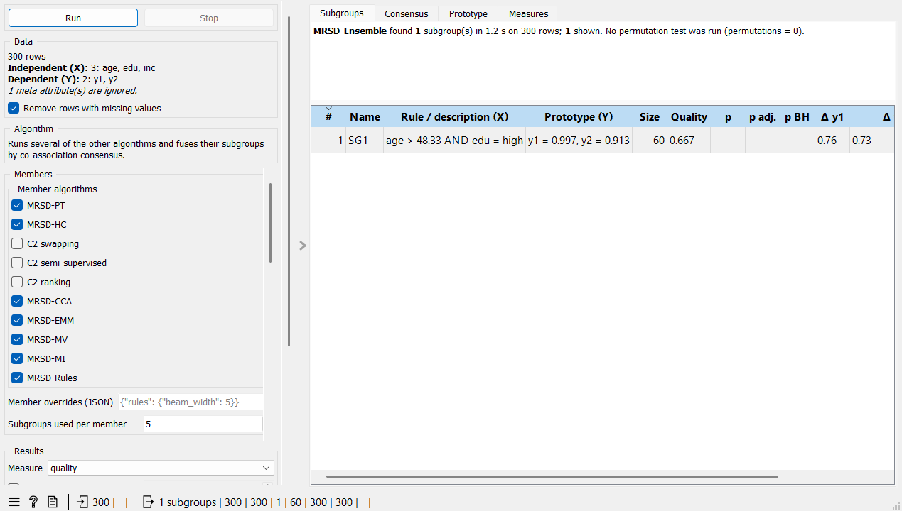
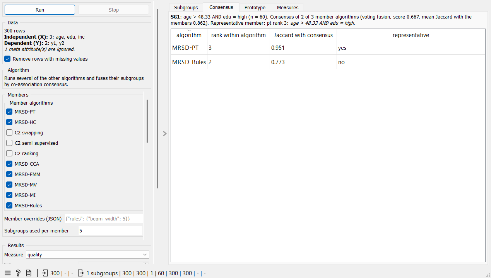
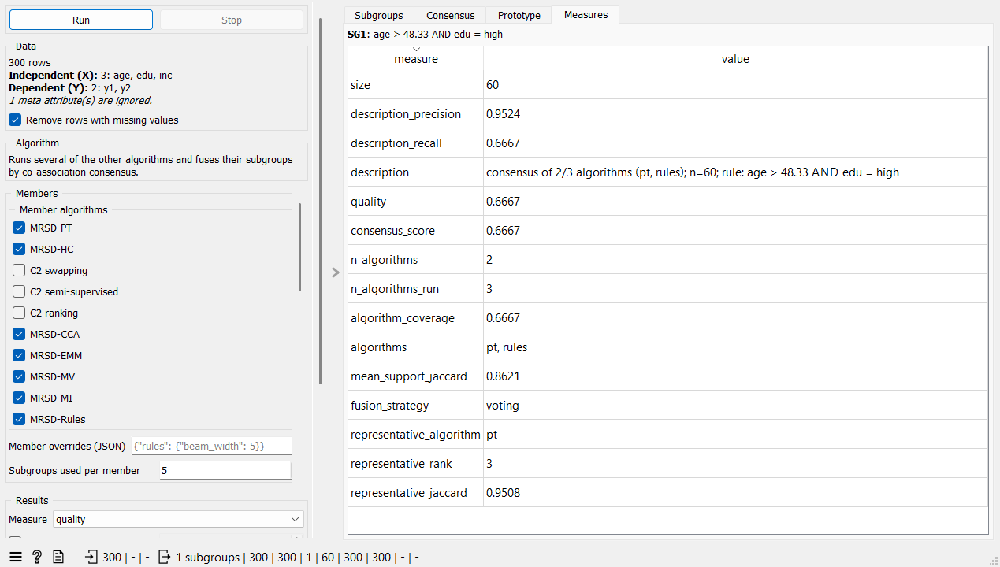
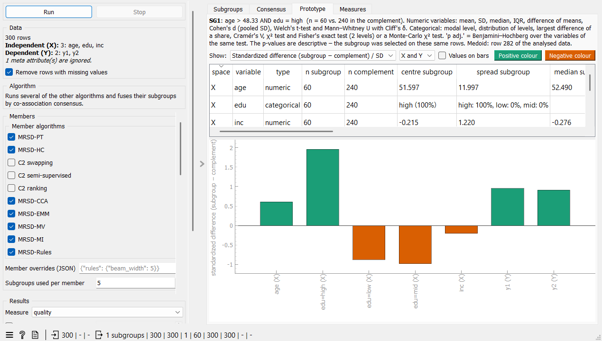

# MRSD-Ensemble: Consensus

Runs several of the other algorithms and fuses their subgroups.

## Inputs

| input | type | meaning |
|---|---|---|
| **Data** | Table | independent variables X = attributes, dependent variables Y = class variables; meta attributes are ignored |
| **Subgroups** | Subgroups | optional. If no Data is connected, the data of these subgroups is used. In MRSD-C2 the subgroups are also the starting subgroups of the search |
| **Learner** | Learner (several) | optional Orange learners (Tree, Naive Bayes, Logistic Regression …). In widgets with a *Classifier* tab they describe the selected subgroup and provide the *Model* outputs; in the classification-based algorithms they also replace the built-in classifiers of the search |

## Outputs

| output | type | meaning |
|---|---|---|
| **Subgroups** | Subgroups | the subgroups shown in the table (after the filters of the *Results* box) |
| **Data** | Table | the input data, unchanged – for chaining algorithm widgets |
| **Annotated Data** | Table | the data with one Yes/No meta column per shown subgroup |
| **Subgroups Table** | Table | one row per subgroup: rule, prototype in Y, size, quality, p-values, statistics of the dependent variables |
| **Selected Subgroup Data** | Table | the rows of the subgroup selected in the table (or chosen in an inspector) |
| **Membership Data (X)** / **(Y)** | Table | all rows with a class `in <subgroup>` (no / yes) and X, respectively Y, as features |
| **Model (X)** / **(Y)** | Model | the membership model of the selected subgroup fitted with a connected Orange learner (for Tree Viewer, Nomogram …) |

## How it works

The chosen member algorithms are run with reduced ("fast") settings, which can
be overridden per member (*Member overrides*); their subgroups are
fused by co-association (how often two instances fall in the same subgroup)
into consensus subgroups supported by several algorithms.  For combining the
results of algorithm widgets you have configured yourself, use *Subgroup
Consolidation* instead.

## Running

*Run* (top and bottom of the control area) starts the computation in a
separate process: Orange stays responsive, other widgets can run at the same
time and *Stop* really stops the run.  *Run in a separate process* can be
switched off if the process cannot be started on your system.  Progress is
written to the console Orange was started from (lines beginning with `[MRSD`).

Rows with missing values in X or Y are removed when *Remove rows with missing
values* is ticked (default).

## Results box

* **Measure** – the algorithm's quality or any numeric measure it records.
* **Show only measure ≥** – filter on the chosen measure.
* **Show only adjusted p <** – filter on the family-wise adjusted p-value
  (only meaningful when permutations > 0).
* **Sort by** – the measure (default), p-values, size or order of discovery.

The filters apply to the table and to the outputs.

## Permutation inference

Permutation tests are **off by default** (Permutations = 0).  When
switched on, the raw p-value, the family-wise adjusted p-value (Westfall–Young
max-T, or a re-run of the whole search on permuted data) and the
Benjamini–Hochberg value are added.  Search-level permutations repeat the
whole search and can be slow.

## Tabs of the main area

* **Subgroups** – the table: rule / description in X, prototype in Y (means
  and modal levels), size, quality, p-values and the difference of every
  dependent variable from the whole data.
* **Consensus** – the member algorithms supporting the subgroup, their ranks
  and Jaccard similarity with the consensus.
* **Prototype** – descriptive statistics of every X and Y variable in the
  subgroup and in its complement (mean, SD, median, IQR or level shares),
  effect sizes, a parametric and a non-parametric test per variable
  (Welch t / Mann–Whitney U; χ² / Fisher exact or Monte-Carlo χ²) and a bar
  chart with several display variants.  The p-values are descriptive: the
  subgroup was selected on the same data.
* **Measures** – everything the algorithm recorded about the subgroup.

## Parameters

| group | parameter | default | notes |
|---|---|---|---|
| Members | Member algorithms | MRSD-PT, MRSD-HC, MRSD-CCA, MRSD-EMM, MRSD-MV, MRSD-MI, MRSD-Rules | Options: MRSD-PT; MRSD-HC; C2 swapping; C2 semi-supervised; C2 ranking; MRSD-CCA; MRSD-EMM; MRSD-MV; MRSD-MI; MRSD-Rules. |
| Members | Member overrides (JSON) | — | Per-member configuration overrides, e.g. {"rules": {"beam_width": 5}} |
| Members | Subgroups used per member | 5 |  |
| Fusion | Fusion | voting | Options: voting; rank aggregation; union; intersection. |
| Fusion | Consensus threshold | 0.5 |  |
| Fusion | Support Jaccard | 0.5 |  |
| Fusion | Minimum supporting algorithms | 2 |  |
| Fusion | RRF constant k | 60 |  |
| Fusion | Weights | equal | Options: equal; custom. |
| Fusion | Custom weights | — |  |
| Subgroup size | Minimum size | 10 | Smallest subgroup reported |
| Subgroup size | Maximum size | automatic (n / 2) | Largest subgroup (automatic = n / 2) |
| Post-processing | Report at most | 20 |  |
| Post-processing | Redundancy threshold (Jaccard) | 0.7 | Subgroups more similar than this to a better one are pruned |
| Post-processing | Max. depth of the describing rule | 3 |  |
| Inference | Permutations (0 = no test) | 0 |  |
| Inference | Inference | whole pipeline re-run under permutation (honest) | Options: whole pipeline re-run under permutation (honest); consensus candidates only (conditional). |
| Inference | Search permutations (search mode) | 50 |  |
| Stability | Bootstrap samples for stability (0 = off) | 0 |  |
| Stability | Bootstrap fraction | 0.8 |  |
| Execution | Time budget (s) | unlimited |  |
| Execution | Skip members that fail | yes |  |
| Other | Random seed | 0 | Fixed seed for reproducible results |

## Screenshots of the tabs

*Tab: consensus*

*Tab: measures*

*Tab: prototype*
