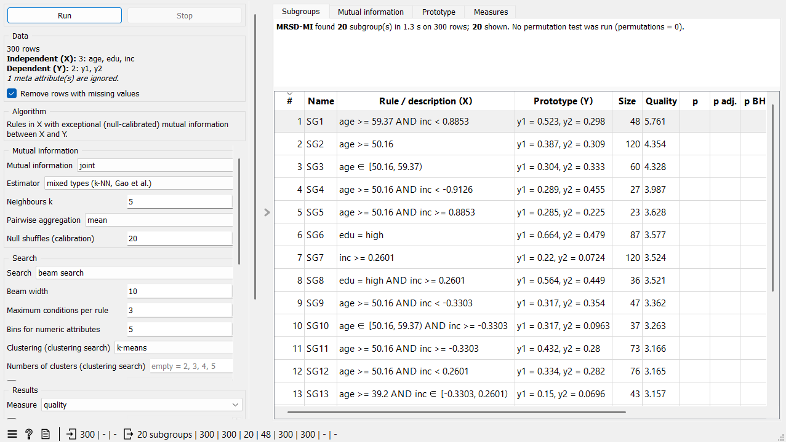
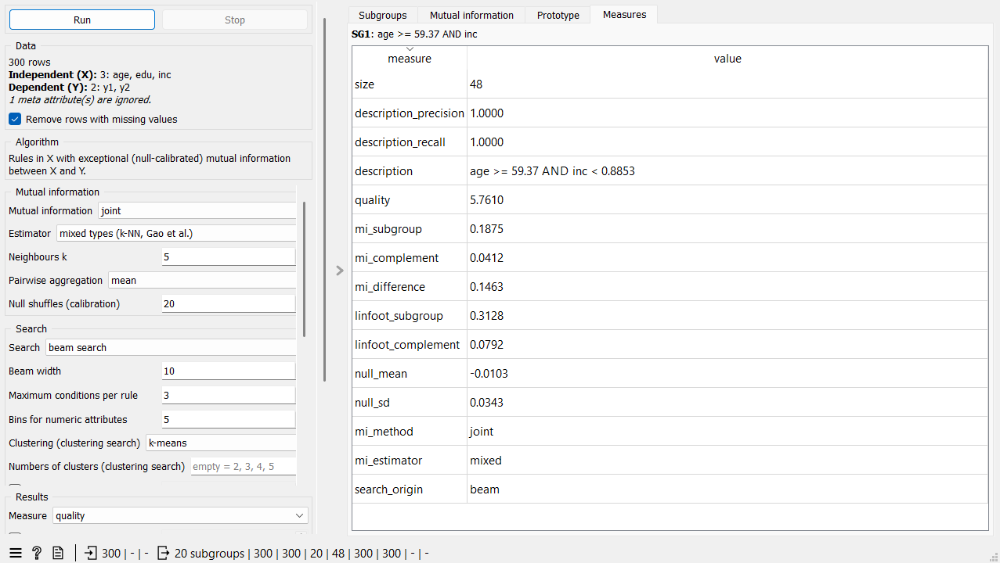
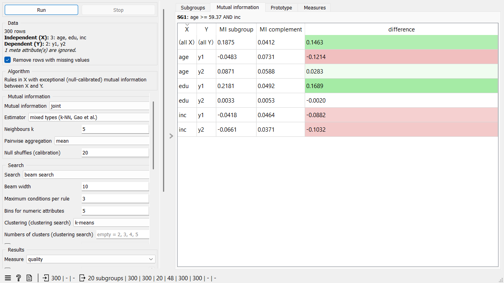
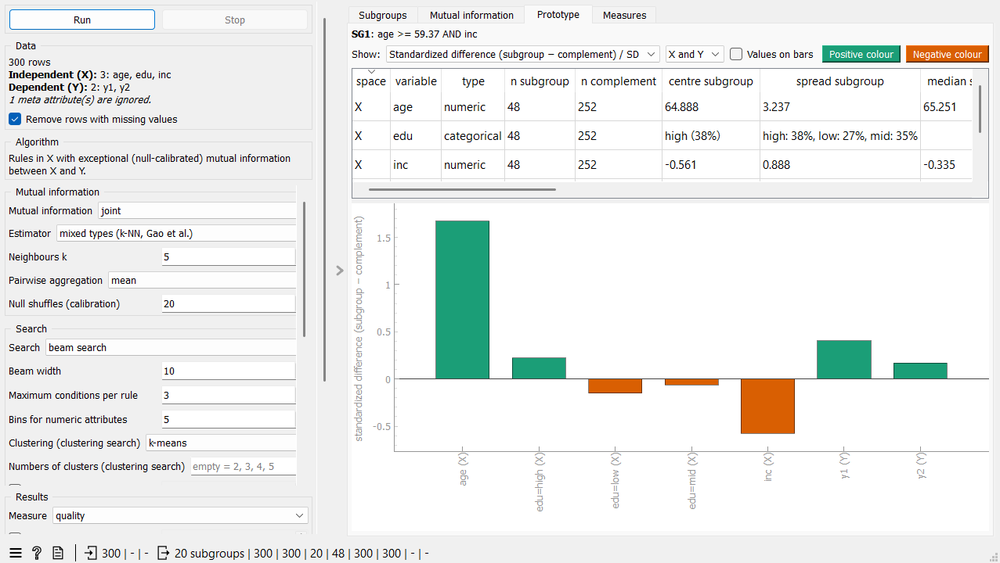

# MRSD-MI: Mutual Information

Rules in X under which X and Y are more dependent than expected.

## Inputs

| input | type | meaning |
|---|---|---|
| **Data** | Table | independent variables X = attributes, dependent variables Y = class variables; meta attributes are ignored |
| **Subgroups** | Subgroups | optional. If no Data is connected, the data of these subgroups is used. In MRSD-C2 the subgroups are also the starting subgroups of the search |
| **Learner** | Learner (several) | optional Orange learners (Tree, Naive Bayes, Logistic Regression …). In widgets with a *Classifier* tab they describe the selected subgroup and provide the *Model* outputs; in the classification-based algorithms they also replace the built-in classifiers of the search |

## Outputs

| output | type | meaning |
|---|---|---|
| **Subgroups** | Subgroups | the subgroups shown in the table (after the filters of the *Results* box) |
| **Data** | Table | the input data, unchanged – for chaining algorithm widgets |
| **Annotated Data** | Table | the data with one Yes/No meta column per shown subgroup |
| **Subgroups Table** | Table | one row per subgroup: rule, prototype in Y, size, quality, p-values, statistics of the dependent variables |
| **Selected Subgroup Data** | Table | the rows of the subgroup selected in the table (or chosen in an inspector) |
| **Membership Data (X)** / **(Y)** | Table | all rows with a class `in <subgroup>` (no / yes) and X, respectively Y, as features |
| **Model (X)** / **(Y)** | Model | the membership model of the selected subgroup fitted with a connected Orange learner (for Tree Viewer, Nomogram …) |

## How it works

Candidates are rules in X (beam search) or clusters.  Inside a candidate the
mutual information between X and Y is estimated and standardized against
shuffles of the Y rows within the candidate (z-score), which removes the
dependence of the raw estimate on the subgroup size.  The default estimator
(Gao et al., 2017) is consistent for numeric, categorical and mixed variables;
the KSG estimator (numeric) and a binning estimator are also available.  The
method looks for a changed *dependence*, not for a shift of the mean.

## Running

*Run* (top and bottom of the control area) starts the computation in a
separate process: Orange stays responsive, other widgets can run at the same
time and *Stop* really stops the run.  *Run in a separate process* can be
switched off if the process cannot be started on your system.  Progress is
written to the console Orange was started from (lines beginning with `[MRSD`).

Rows with missing values in X or Y are removed when *Remove rows with missing
values* is ticked (default).

## Results box

* **Measure** – the algorithm's quality or any numeric measure it records.
* **Show only measure ≥** – filter on the chosen measure.
* **Show only adjusted p <** – filter on the family-wise adjusted p-value
  (only meaningful when permutations > 0).
* **Sort by** – the measure (default), p-values, size or order of discovery.

The filters apply to the table and to the outputs.

## Permutation inference

Permutation tests are **off by default** (Permutations = 0).  When
switched on, the raw p-value, the family-wise adjusted p-value (Westfall–Young
max-T, or a re-run of the whole search on permuted data) and the
Benjamini–Hochberg value are added.  Search-level permutations repeat the
whole search and can be slow.

## Tabs of the main area

* **Subgroups** – the table: rule / description in X, prototype in Y (means
  and modal levels), size, quality, p-values and the difference of every
  dependent variable from the whole data.
* **Mutual information** – the joint and every pairwise X–Y mutual
  information inside the subgroup and in the complement.
* **Prototype** – descriptive statistics of every X and Y variable in the
  subgroup and in its complement (mean, SD, median, IQR or level shares),
  effect sizes, a parametric and a non-parametric test per variable
  (Welch t / Mann–Whitney U; χ² / Fisher exact or Monte-Carlo χ²) and a bar
  chart with several display variants.  The p-values are descriptive: the
  subgroup was selected on the same data.
* **Measures** – everything the algorithm recorded about the subgroup.

## Parameters

| group | parameter | default | notes |
|---|---|---|---|
| Mutual information | Mutual information | joint | Options: joint; pairwise; combined. |
| Mutual information | Estimator | mixed types (k-NN, Gao et al.) | mixed: consistent for numeric, categorical and mixed variables (Gao et al. 2017); k-NN (KSG): numeric variables only – categorical ones are one-hot coded and jittered Options: mixed types (k-NN, Gao et al.); k-NN (KSG, numeric); binning. |
| Mutual information | Neighbours k | 5 |  |
| Mutual information | Pairwise aggregation | mean | Options: mean; sum; maximum; minimum; Frobenius. |
| Mutual information | Null shuffles (calibration) | 20 |  |
| Search | Search | beam search | Options: beam search; clustering. |
| Search | Beam width | 10 |  |
| Search | Maximum conditions per rule | 3 |  |
| Search | Bins for numeric attributes | 5 |  |
| Search | Clustering (clustering search) | k-means | Options: k-means; k-medoids; agglomerative; spectral. |
| Search | Numbers of clusters (clustering search) | — |  |
| Search | Single number of clusters | use list |  |
| Subgroup size | Minimum size | 20 | Smallest subgroup reported |
| Subgroup size | Maximum size | automatic (n / 2) | Largest subgroup (automatic = n / 2) |
| Post-processing | Minimum exceptionality (z) | 0.0 |  |
| Post-processing | Report at most | 20 |  |
| Post-processing | Redundancy threshold (Jaccard) | 0.7 | Subgroups more similar than this to a better one are pruned |
| Inference | Permutations (0 = no test) | 0 |  |
| Inference | Family-wise correction over | all evaluated candidates (search) | Options: all evaluated candidates (search); returned candidates only. |
| Other | Random seed | 0 | Fixed seed for reproducible results |

## Screenshots of the tabs

*Tab: measures*

*Tab: mutual information*

*Tab: prototype*
