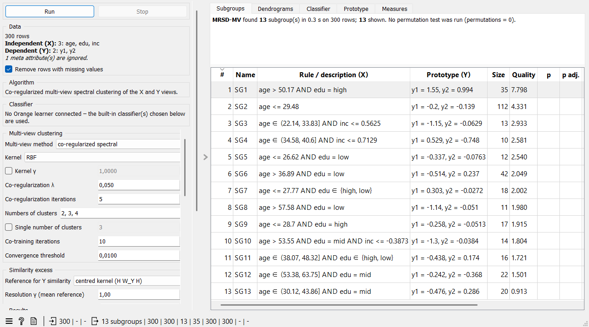
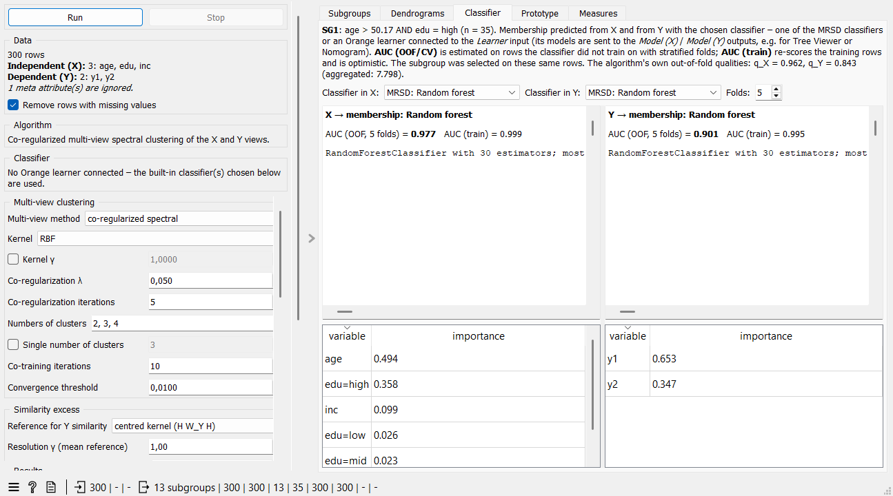
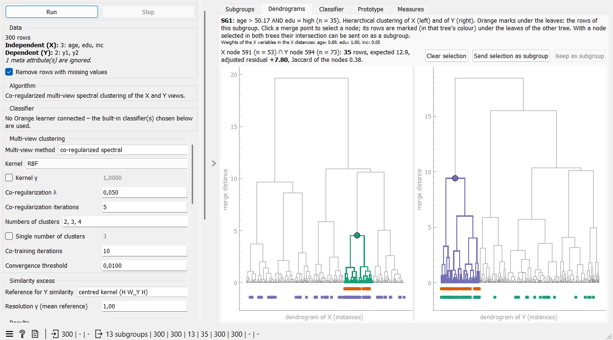
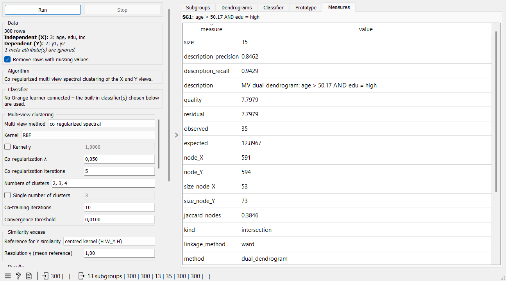
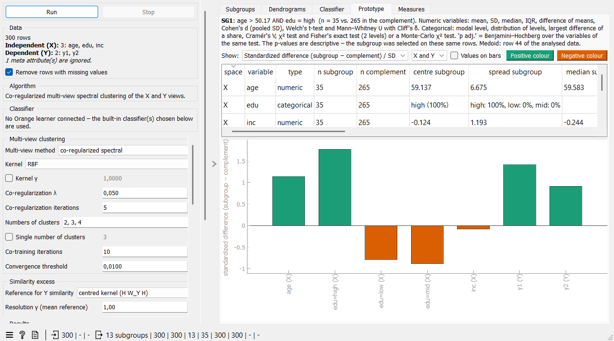

# MRSD-MV: Multi-View

X and Y are two views of the same instances; subgroups are coherent in both.

## Inputs

| input | type | meaning |
|---|---|---|
| **Data** | Table | independent variables X = attributes, dependent variables Y = class variables; meta attributes are ignored |
| **Subgroups** | Subgroups | optional. If no Data is connected, the data of these subgroups is used. In MRSD-C2 the subgroups are also the starting subgroups of the search |
| **Learner** | Learner (several) | optional Orange learners (Tree, Naive Bayes, Logistic Regression …). In widgets with a *Classifier* tab they describe the selected subgroup and provide the *Model* outputs; in the classification-based algorithms they also replace the built-in classifiers of the search |

## Outputs

| output | type | meaning |
|---|---|---|
| **Subgroups** | Subgroups | the subgroups shown in the table (after the filters of the *Results* box) |
| **Data** | Table | the input data, unchanged – for chaining algorithm widgets |
| **Annotated Data** | Table | the data with one Yes/No meta column per shown subgroup |
| **Subgroups Table** | Table | one row per subgroup: rule, prototype in Y, size, quality, p-values, statistics of the dependent variables |
| **Selected Subgroup Data** | Table | the rows of the subgroup selected in the table (or chosen in an inspector) |
| **Membership Data (X)** / **(Y)** | Table | all rows with a class `in <subgroup>` (no / yes) and X, respectively Y, as features |
| **Model (X)** / **(Y)** | Model | the membership model of the selected subgroup fitted with a connected Orange learner (for Tree Viewer, Nomogram …) |

## How it works

Six methods are available.

* **Co-regularized spectral** (default), **averaged affinities**,
  **co-training**, **late fusion** – multi-view clusterings; every cluster is
  a candidate.  Quality = ½ · (agreement of the two single-view clusterings
  inside the cluster minus outside) + ½ · min(q_X, q_Y).
* **Similarity excess** – no clustering.  With the similarity matrices W_X and
  W_Y, the pairwise excess is B = W_X ∘ (H·W_Y·H) (Y kernel centred); a
  subgroup maximises Q(G) = Σ B over pairs in G / |G|^a (leading eigenvector,
  best prefix, single-instance moves; further subgroups by deflation).
* **Dual dendrogram** – hierarchical clustering of X and of Y; a candidate is
  the intersection of a node of each tree, scored by the adjusted residual of
  that cell of the 2 × 2 table; only local maxima over parent / child moves
  are kept.

For the last two methods the X variables can be weighted by their relevance
for Y (kernel alignment), so that unrelated variables do not dilute the X
similarity, and their scores are not calibrated against selection – judge
them with the permutation test or the common measures of *Subgroup
Consolidation*.  On the bundled data with planted subgroups these two
methods recover the planted subgroups only partly.

## Classifiers

Without a connected learner the built-in classifiers chosen in the widget are
used.  When at least one Orange learner is connected to the *Learner* input,
*Use the connected Orange learner(s)* appears (ticked) and the built-in
choice is hidden: *Learner for X* and *Learner for Y* choose which connected learner is used in which space.  Slow learners (random forest, SVM) make the search
slow, because every candidate is scored by cross-validation.

## Running

*Run* (top and bottom of the control area) starts the computation in a
separate process: Orange stays responsive, other widgets can run at the same
time and *Stop* really stops the run.  *Run in a separate process* can be
switched off if the process cannot be started on your system.  Progress is
written to the console Orange was started from (lines beginning with `[MRSD`).

Rows with missing values in X or Y are removed when *Remove rows with missing
values* is ticked (default).

## Results box

* **Measure** – the algorithm's quality or any numeric measure it records.
* **Show only measure ≥** – filter on the chosen measure.
* **Show only adjusted p <** – filter on the family-wise adjusted p-value
  (only meaningful when permutations > 0).
* **Sort by** – the measure (default), p-values, size or order of discovery.

The filters apply to the table and to the outputs.

## Permutation inference

Permutation tests are **off by default** (Permutations = 0).  When
switched on, the raw p-value, the family-wise adjusted p-value (Westfall–Young
max-T, or a re-run of the whole search on permuted data) and the
Benjamini–Hochberg value are added.  Search-level permutations repeat the
whole search and can be slow.

## Tabs of the main area

* **Subgroups** – the table: rule / description in X, prototype in Y (means
  and modal levels), size, quality, p-values and the difference of every
  dependent variable from the whole data.
* **Dendrograms** – the dendrograms of X and of Y side by side.  The rows of
  the selected subgroup are marked under the leaves of both trees.  Click a
  merge point in one tree to select a node: its rows are marked under the
  leaves of the other tree, showing where the same instances lie in the other
  space.  With a node selected in each tree the intersection can be sent on
  (*Send selection as subgroup*) and kept.
* **Classifier** – membership classifiers in X and in Y.
* **Prototype** – descriptive statistics of every X and Y variable in the
  subgroup and in its complement (mean, SD, median, IQR or level shares),
  effect sizes, a parametric and a non-parametric test per variable
  (Welch t / Mann–Whitney U; χ² / Fisher exact or Monte-Carlo χ²) and a bar
  chart with several display variants.  The p-values are descriptive: the
  subgroup was selected on the same data.
* **Measures** – everything the algorithm recorded about the subgroup.

## Parameters

| group | parameter | default | notes |
|---|---|---|---|
| Multi-view clustering | Multi-view method | co-regularized spectral | Options: co-regularized spectral; averaged affinities; co-training; late fusion; similarity excess (W_X vs W_Y, no clustering); dual dendrogram (nodes of X × nodes of Y). |
| Multi-view clustering | Kernel | RBF | Options: RBF; linear; polynomial; cosine; Laplacian. |
| Multi-view clustering | Kernel γ | automatic |  |
| Multi-view clustering | Co-regularization λ | 0.05 |  |
| Multi-view clustering | Co-regularization iterations | 5 |  |
| Multi-view clustering | Numbers of clusters | 2, 3, 4 |  |
| Multi-view clustering | Single number of clusters | use list |  |
| Multi-view clustering | Co-training iterations | 10 |  |
| Multi-view clustering | Convergence threshold | 0.01 |  |
| Similarity excess | Reference for Y similarity | centred kernel (H W_Y H) | centered: pairs deviating from the centre of Y in the same direction; mean: similarity above the average (rewards any dense set) Options: centred kernel (H W_Y H); mean similarity (W_Y − γ·mean). |
| Similarity excess | Resolution γ (mean reference) | 1.0 |  |
| Similarity excess | Size exponent a in Q = Σ B / |G|^a | 1.0 | 1 favours larger subgroups, 2 small tight ones |
| Similarity excess | Subgroups to extract | 5 |  |
| Dual dendrogram | Linkage (both dendrograms) | Ward | Options: Ward; complete; average; single. |
| X variable weights (excess, dual dendrogram) | Weights of X variables | relevance for Y (kernel alignment) | relevance: each X variable is weighted by its kernel alignment with Y, so that variables unrelated to Y do not dilute the X similarity Options: relevance for Y (kernel alignment); none (all equal). |
| X variable weights (excess, dual dendrogram) | Sharpness of the weights | 2.0 | weights = (alignment / max alignment) ^ power |
| Classification | Report classification quality | yes |  |
| Classification | Classifier in X | Decision tree | Options: Random forest; Decision tree; Logistic regression; SVM (RBF); SVM (linear); Naive Bayes; k-nearest neighbours; Gradient boosting; AdaBoost; Neural network (MLP). |
| Classification | Classifier in Y | Decision tree | Options: Random forest; Decision tree; Logistic regression; SVM (RBF); SVM (linear); Naive Bayes; k-nearest neighbours; Gradient boosting; AdaBoost; Neural network (MLP). |
| Subgroup size | Minimum size | 10 | Smallest subgroup reported |
| Subgroup size | Maximum size | automatic (n / 2) | Largest subgroup (automatic = n / 2) |
| Post-processing | Report at most | 20 |  |
| Post-processing | Redundancy threshold (Jaccard) | 0.7 | Subgroups more similar than this to a better one are pruned |
| Inference | Permutations (0 = no test) | 0 |  |
| Inference | Statistic | Y shift on the X rule of the cluster | Options: Y shift on the X rule of the cluster; Y shift on the cluster. |
| Inference | Family-wise correction over | all evaluated candidates (search) | Options: all evaluated candidates (search); returned candidates only. |
| Other | Random seed | 0 | Fixed seed for reproducible results |

## Screenshots of the tabs

*Tab: classifier*

*Tab: dendrograms*

*Tab: measures*

*Tab: prototype*
