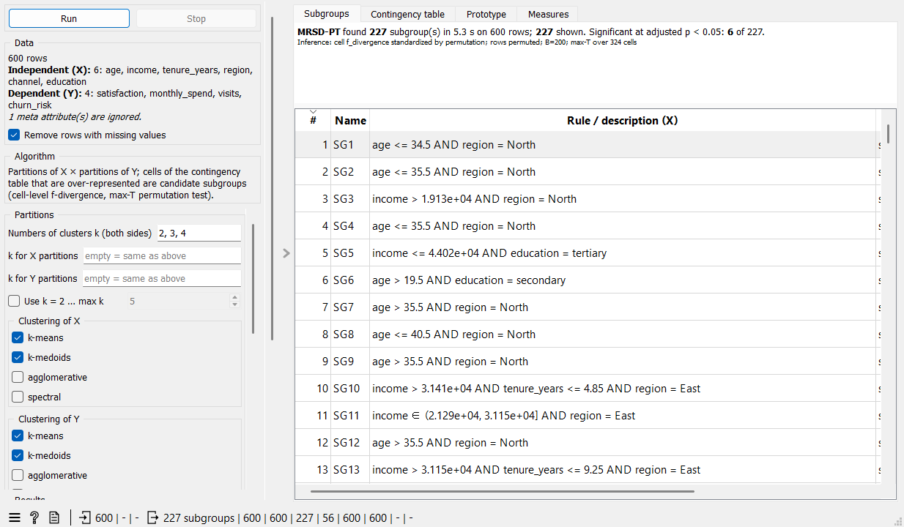
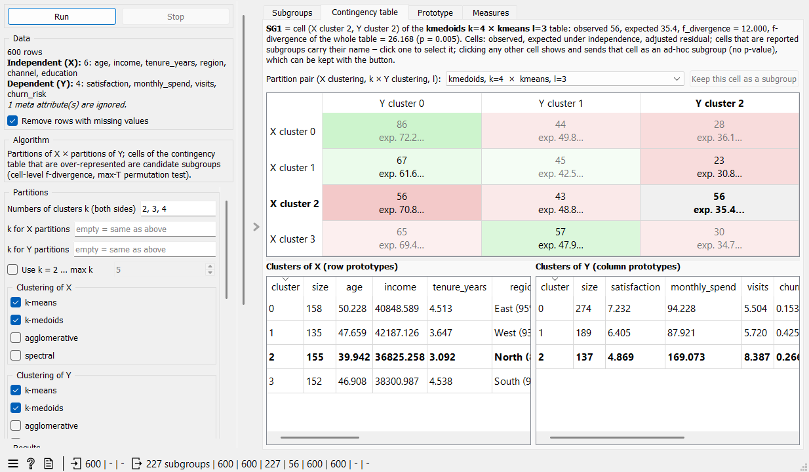
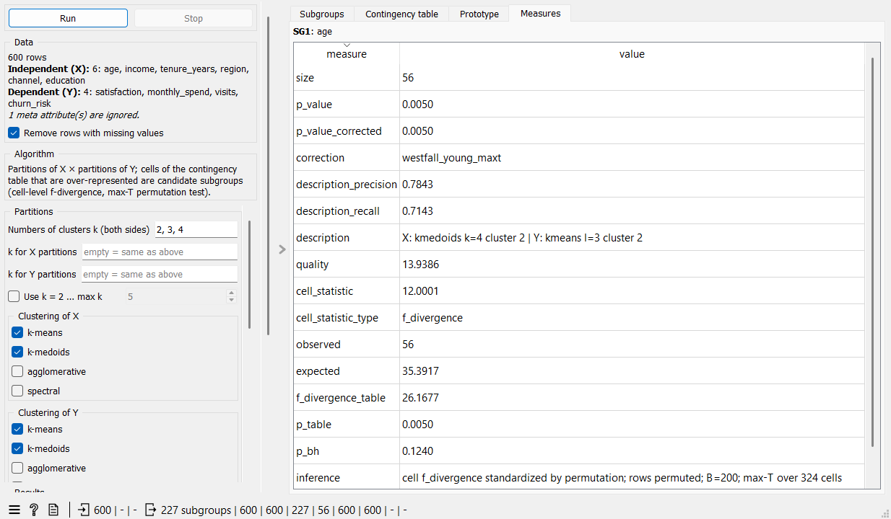
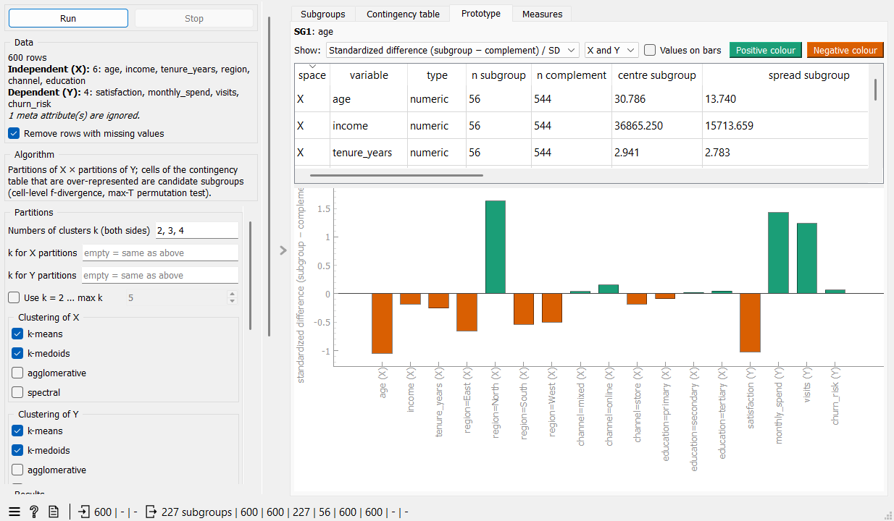

# MRSD-PT: Partitioning and Tables

Subgroups are cells of the contingency tables of pairs of partitions of X and of Y.

## Inputs

| input | type | meaning |
|---|---|---|
| **Data** | Table | independent variables X = attributes, dependent variables Y = class variables; meta attributes are ignored |
| **Subgroups** | Subgroups | optional. If no Data is connected, the data of these subgroups is used. In MRSD-C2 the subgroups are also the starting subgroups of the search |
| **Learner** | Learner (several) | optional Orange learners (Tree, Naive Bayes, Logistic Regression …). In widgets with a *Classifier* tab they describe the selected subgroup and provide the *Model* outputs; in the classification-based algorithms they also replace the built-in classifiers of the search |

## Outputs

| output | type | meaning |
|---|---|---|
| **Subgroups** | Subgroups | the subgroups shown in the table (after the filters of the *Results* box) |
| **Data** | Table | the input data, unchanged – for chaining algorithm widgets |
| **Annotated Data** | Table | the data with one Yes/No meta column per shown subgroup |
| **Subgroups Table** | Table | one row per subgroup: rule, prototype in Y, size, quality, p-values, statistics of the dependent variables |
| **Selected Subgroup Data** | Table | the rows of the subgroup selected in the table (or chosen in an inspector) |
| **Membership Data (X)** / **(Y)** | Table | all rows with a class `in <subgroup>` (no / yes) and X, respectively Y, as features |
| **Model (X)** / **(Y)** | Model | the membership model of the selected subgroup fitted with a connected Orange learner (for Tree Viewer, Nomogram …) |

## How it works

Several partitions of X and of Y are built (clustering with several numbers of
clusters, and the natural partition by the combinations of categorical
variables).  For every pair (partition of X, partition of Y) the contingency
table is formed; a cell that holds more instances than expected under
independence is a candidate subgroup: instances that are alike in X and alike
in Y.  The cell statistic is the cell's contribution to an f-divergence (χ² by
default) or the squared adjusted residual; significance is assessed by
permuting the rows (max-T over all cells).

## Running

*Run* (top and bottom of the control area) starts the computation in a
separate process: Orange stays responsive, other widgets can run at the same
time and *Stop* really stops the run.  *Run in a separate process* can be
switched off if the process cannot be started on your system.  Progress is
written to the console Orange was started from (lines beginning with `[MRSD`).

Rows with missing values in X or Y are removed when *Remove rows with missing
values* is ticked (default).

## Results box

* **Measure** – the algorithm's quality or any numeric measure it records.
* **Show only measure ≥** – filter on the chosen measure.
* **Show only adjusted p <** – filter on the family-wise adjusted p-value
  (only meaningful when permutations > 0).
* **Sort by** – the measure (default), p-values, size or order of discovery.

The filters apply to the table and to the outputs.

## Permutation inference

Permutation tests are **off by default** (Permutations = 0) – except in this widget, where the permutation test is the core of the method (1000 permutations).  When
switched on, the raw p-value, the family-wise adjusted p-value (Westfall–Young
max-T, or a re-run of the whole search on permuted data) and the
Benjamini–Hochberg value are added.  Search-level permutations repeat the
whole search and can be slow.

## Tabs of the main area

* **Subgroups** – the table: rule / description in X, prototype in Y (means
  and modal levels), size, quality, p-values and the difference of every
  dependent variable from the whole data.
* **Contingency table** – the table of the partition pair of the selected
  subgroup: observed count, expected count and adjusted residual in every
  cell; below it the prototypes (means / modal levels, medoid) of the clusters
  of X and of Y.  Click a cell that is a reported subgroup to select it; click
  any other cell to send it on as an ad-hoc subgroup (*Keep this cell as a
  subgroup* adds it to the results).
* **Prototype** – descriptive statistics of every X and Y variable in the
  subgroup and in its complement (mean, SD, median, IQR or level shares),
  effect sizes, a parametric and a non-parametric test per variable
  (Welch t / Mann–Whitney U; χ² / Fisher exact or Monte-Carlo χ²) and a bar
  chart with several display variants.  The p-values are descriptive: the
  subgroup was selected on the same data.
* **Measures** – everything the algorithm recorded about the subgroup.

## Parameters

| group | parameter | default | notes |
|---|---|---|---|
| Partitions | Numbers of clusters k (both sides) | 2, 3, 4, 5 | Cluster counts used for X and for Y when the side-specific lists are empty |
| Partitions | k for X partitions | — | Overrides the shared list for X |
| Partitions | k for Y partitions | — | Overrides the shared list for Y |
| Partitions | Use k = 2 … max k | off | Shorthand for the shared list of k values |
| Partitions | Clustering of X | k-means, k-medoids | Options: k-means; k-medoids; agglomerative; spectral. |
| Partitions | Clustering of Y | k-means, k-medoids | Options: k-means; k-medoids; agglomerative; spectral. |
| Partitions | Natural partition of X (categorical combinations) | yes |  |
| Partitions | Natural partition of Y (categorical combinations) | yes |  |
| Partitions | Max. natural partition cells | 20 |  |
| Statistic | f-divergence | χ² (Pearson) | Options: χ² (Pearson); total variation; Kullback–Leibler; reverse KL; Hellinger; Jensen–Shannon; Neyman; α-divergence. |
| Statistic | Cell statistic | cell f-divergence contribution | Options: cell f-divergence contribution; squared adjusted residual. |
| Inference | Permutations (0 = no test) | 1000 |  |
| Inference | Significance level α | 0.05 |  |
| Subgroup size | Minimum size | 5 | Smallest subgroup reported |
| Subgroup size | Maximum size | automatic (n / 2) | Largest subgroup (automatic = n / 2) |
| Post-processing | Redundancy threshold (Jaccard) | 0.7 | Subgroups more similar than this to a better one are pruned |
| Other | Random seed | 0 | Fixed seed for reproducible results |

## Screenshots of the tabs

*Tab: contingency table*

*Tab: measures*

*Tab: prototype*
