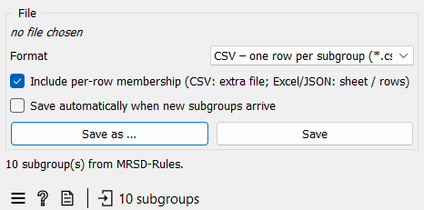

# Save Subgroups

Writes the subgroups to a file.

**Inputs:** *Subgroups*.

Formats: CSV (one row per subgroup; optionally a second file with the
membership of every row), Excel (sheets for subgroups, effects, membership and
configuration; needs `openpyxl`), JSON (everything including the covered
rows), pickle (for *Load Subgroups*) and a text report.
