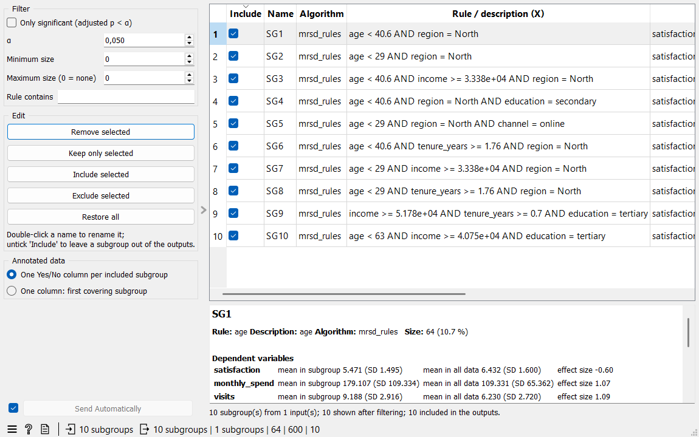

# Subgroup Browser

Inspect, filter, rename, remove and select subgroups from one or several
algorithm widgets.

**Inputs:** *Subgroups* (several).
**Outputs:** *Subgroups* (the included ones that pass the filters),
*Selected Subgroups*, *Selected Data* (rows covered by the selected
subgroups), *Annotated Data*, *Subgroups Table*.

* Filters: adjusted p below α, size limits, text contained in the rule.
* Double-click a name to rename a subgroup; untick *Include* to leave it out
  of the outputs; *Remove selected* / *Keep only selected* / *Restore all*.
* The lower pane shows the details of the selected subgroup, including the
  statistics of the dependent variables and all recorded measures.
* *Annotated data*: one Yes/No column per subgroup, or a single column with
  the first covering subgroup.
