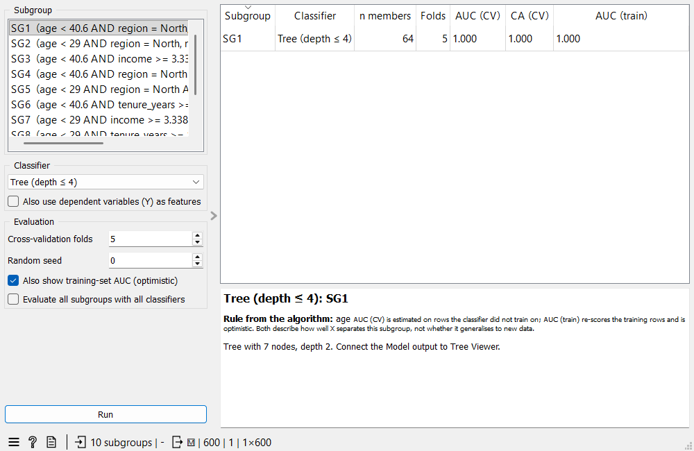

# Subgroup Classifier

Describes a subgroup (membership yes / no) with any Orange classifier.

**Inputs:** *Subgroups*, *Learner* (several).
**Outputs:** *Model*, *Membership Data*, *Evaluation*, *Evaluation Results*.

AUC and CA are estimated with stratified cross-validation; the training AUC is
shown separately and is optimistic.  The subgroup itself was found on the same
data, so even the cross-validated AUC measures how describable the subgroup is
in X, not whether it would be found again.  The algorithm widgets offer the
same through their *Learner* input and *Model* outputs; this widget is for
subgroups coming from the Browser or Consolidation.
