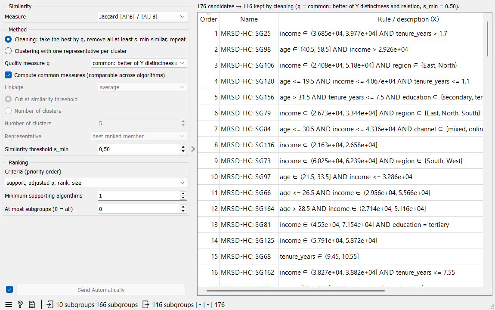

# Subgroup Consolidation

Chooses a non-redundant set of subgroups from many candidates, typically the
outputs of several algorithms.

**Inputs:** *Subgroups* (several).
**Outputs:** *Selected Subgroups*, *Clustered Subgroups*, *Clusters Table*,
*Similarity Matrix*.

## Common measures

The algorithms' own quality scores are on different scales.  With *Compute
common measures* (default) three measures are computed for every candidate
from its rows alone, in the same way whatever algorithm found it; all are in
[0, 1], larger is better, and 1 need not be attainable:

* **Y distinctness** – 2·AUC − 1 of predicting membership from Y
  (out-of-fold, decision tree).
* **X describability** – the same from X.
* **Relation exceptionality** – the share of the subgroup's own variation of
  Y that is explained only when the model of Y from X may differ inside the
  subgroup (cross-validated regression).  Captures a shifted level as well as
  a changed slope, which Y distinctness does not see.  Its values are small
  even for real subgroups; use it for ordering rather than with a threshold.

They are computed on the data the subgroups were found on, so they are
optimistic; they serve to compare subgroups.

## Methods

* **Cleaning** (default): repeatedly take the best candidate by the quality q,
  add it to the result and remove every candidate at least s_min similar to
  it.  q can be one of the common measures (default: the better of Y
  distinctness and relation exceptionality), the algorithm's own score, a
  p-value, the rank within the algorithm or the size.
* **Clustering**: hierarchical clustering of the candidates on their
  similarity, cut at a threshold or into a number of clusters, with one
  representative per cluster.  *Support* is the number of different
  algorithms in a cluster.

Similarity is the Jaccard, overlap or Dice coefficient of the row sets.
