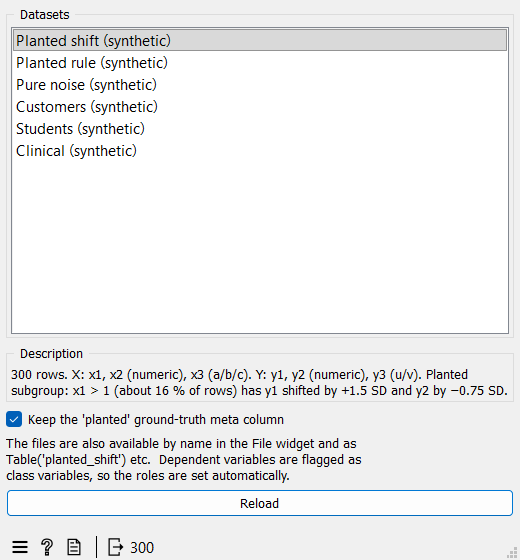

# Subgroup Datasets

Loads the example datasets bundled with the add-on.

**Outputs:** *Data* – the chosen dataset with the dependent variables as class
variables.

Every dataset has several dependent variables and a meta column `planted`
with the ground truth of the planted subgroup(s); the algorithms ignore meta
columns, so the column can be used to check the results (e.g. as colour in a
Scatter Plot of the *Annotated Data*).  The files are also found by name by
Orange's *File* widget, which sets the roles automatically.

| name | description |
|---|---|
| `planted_shift` | 300 rows. X: x1, x2 (numeric), x3 (a/b/c). Y: y1, y2 (numeric), y3 (u/v). Planted subgroup: x1 > 1 (about 16 % of rows) has y1 shifted by +1.5 SD and y2 by −0.75 SD. |
| `planted_rule` | 300 rows. X: age, edu (low/mid/high), inc. Y: y1, y2. Planted subgroup: edu = high AND age ≥ 50 has y1 shifted by +1.5 SD and y2 by +0.75 SD. |
| `pure_noise` | 300 rows. X: x1–x4, x_cat. Y: y1–y3. X and Y are independent – nothing should be significant (a check of the false-positive control of the permutation tests). |
| `customers` | 600 rows. X: age, income, tenure_years, region, channel, education. Y: satisfaction, monthly_spend, visits, churn_risk. Two planted subgroups: region = North AND age < 35 (higher spend and visits, lower satisfaction) and education = tertiary AND high income (higher satisfaction, lower churn risk). |
| `students` | 400 rows. X: study_hours, attendance, sleep_hours, parental_education, program. Y: math, reading, science, wellbeing. Planted: sleep_hours < 6.2 AND study_hours > 5 (lower wellbeing, higher math and science) and program = arts (higher reading, lower science). |
| `clinical` | 350 rows. X: age, bmi, smoker, activity, sex. Y: systolic, cholesterol, glucose, hdl. Planted: smoker = yes AND bmi > 28 (higher systolic pressure and glucose, lower HDL). |
