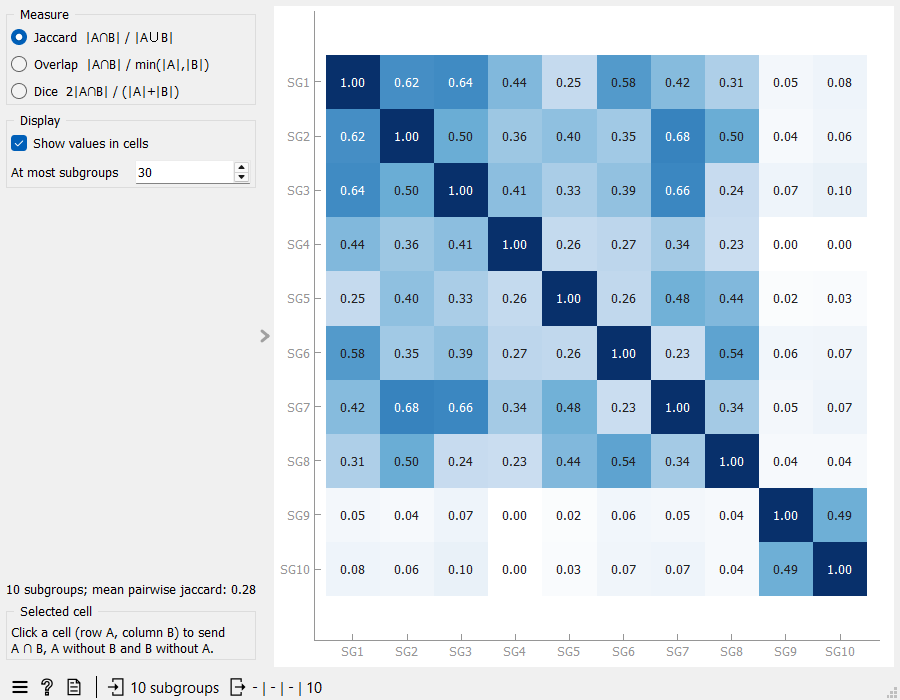

# Subgroup Overlap

Heat map of the pairwise overlap of the subgroups.

**Inputs:** *Subgroups*.
**Outputs:** *Intersection*, *First Only*, *Second Only*, *Overlap Matrix*.

The measure is the Jaccard, overlap or Dice coefficient.  Click a cell (row A,
column B) to send the rows in both subgroups (*Intersection*), in A but not in
B (*First Only*) and in B but not in A (*Second Only*).
