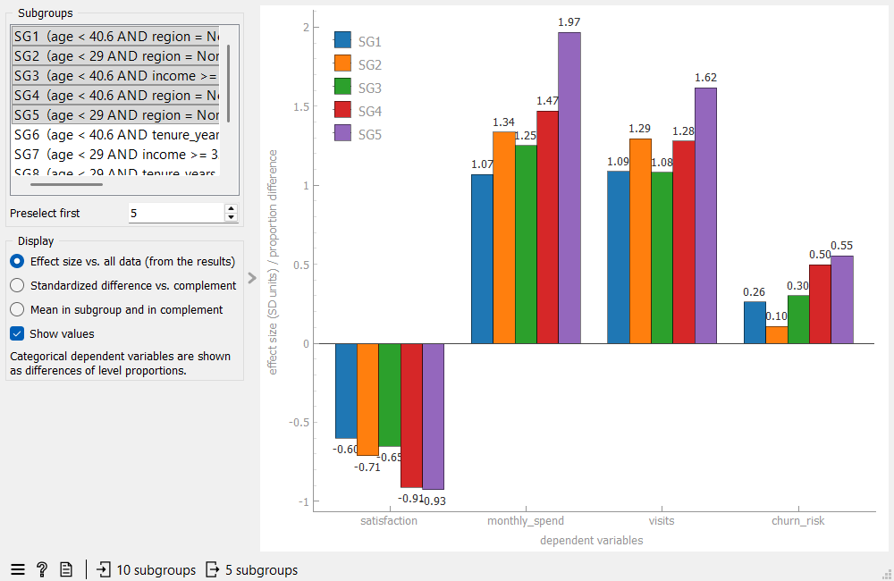

# Subgroup Profile

Bar chart of the dependent variables inside the chosen subgroups.

**Inputs:** *Subgroups*.  **Outputs:** *Selected Subgroups*.

Display: effect size against all data, standardized difference against the
complement, or the means in the subgroup and in the complement.  Categorical
dependent variables are shown as differences of level shares.
