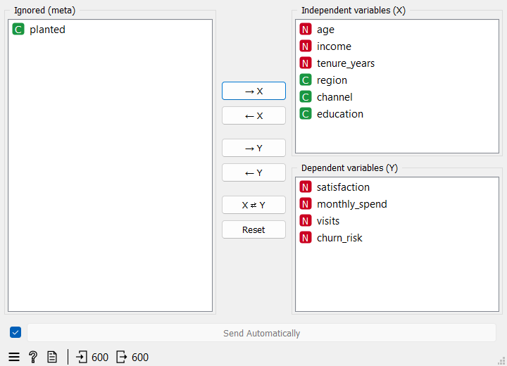

# Variable Roles

Sets which variables are independent (X), dependent (Y) or ignored.

**Inputs:** *Data*.  **Outputs:** *Data* with X as attributes, Y as class
variables and the ignored variables as metas – the form the algorithm widgets
expect.

Move variables between the three lists with the buttons or by dragging;
*X ⇄ Y* swaps the two roles and *Reset* restores the roles of the input.
Orange's *Select Columns* widget can be used instead.
